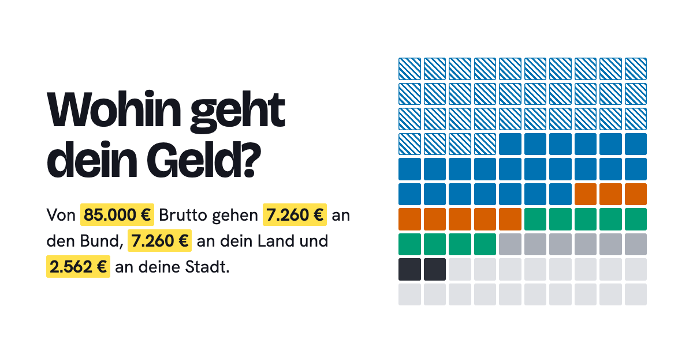

<div align="center">

# Haushalts-Check

**Wohin geht deine Lohnsteuer?** Trag dein Brutto ein, wähl deine Stadt, und sieh, wie viel bei Bund, Land und Stadt ankommt und wofür sie es ausgeben.

[](https://github.com/nimble-123/haushalts-check/actions/workflows/ci.yml)
[](https://haushalts-check.vercel.app)
[](LICENSE)
[](https://www.govdata.de/dl-de/by-2-0)

[](.nvmrc)
[](https://astro.build)
[](tsconfig.json)
[](biome.json)
[](vitest.config.ts)
[](playwright.config.ts)
[-14161f)](tests/e2e/rente-und-mehr.spec.ts)



</div>

## Was die Seite kann

- **Persönliche Aufteilung**: Lohnsteuer und Soli (Tarif 2026, Steuerklasse I) und Sozialabgaben, verteilt auf Bund, Land und Stadt, und dort auf die Ausgabenbereiche. Auf Wunsch mit geschätzten Konsumsteuern (Mehrwert-, Energie-, Strom- und Versicherungsteuer).
- **Alle 106 kreisfreien Städte** mit eigener Seite (`/stadt/oldenburg/`), dazu alle 16 Länder.
- **Echte Ausgaben je Stadt**: Auszahlungen nach Art je Einwohner im Vergleich zum Schnitt aller kreisfreien Städte.
- **Bundeshaushalt 2026** als Fluss oder Fläche, Entwurf 2027, Entwicklung bis 2030.
- **Rente oder ETF**: Was der Rentenbeitrag kostet und bringt, verglichen mit einem ETF-Sparplan aus demselben Geld.
- **Für Menschen gemacht**: vorbelegt mit dem Median-Bruttolohn, nächste Stadt per Standort, Eingaben bleiben im Browser, hell und dunkel, barrierearm.

## Daten und Quellen

| Ebene         | Quelle                                                                           | Stand           |
| ------------- | -------------------------------------------------------------------------------- | --------------- |
| Bund          | Haushaltsgesetz 2026, Einzelpläne (Soll)                                         | 2026            |
| Länder        | Destatis, Rechnungsergebnisse des Öffentlichen Gesamthaushalts, Tabelle 71711-12 | 2022            |
| Städte, Zweck | Durchschnitt der Gemeinden und Kreise je Land (gekennzeichnete Schätzung)        | 2022            |
| Städte, Art   | Regionaldatenbank, Rechnungsergebnisse der kommunalen Kernhaushalte, 71717-Z-05  | 2025, vorläufig |
| Städte, Lage  | Destatis, Gemeindeverzeichnis                                                    | 31.12.2025      |
| Konsumsteuern | Destatis, EVS 2018 (Alleinlebende) und Wirtschaftsrechnungen 2024; Steuersätze   | 2026, Schätzung |
| Vorbelegung   | Destatis, Median Bruttojahresverdienst Vollzeit; Durchschnittsalter              | 2025            |

Wie genau gerechnet wird, steht auf der Seite [So ist gerechnet](https://haushalts-check.vercel.app/methodik/). Für einzelne Städte gibt es amtlich keine Aufteilung nach Zweck; die Seite kennzeichnet diese Werte mit ≈.

## Schnellstart

```sh
nvm use      # Node 24
npm ci
npm run dev  # http://localhost:4321
```

| Befehl             | Zweck                                                                |
| ------------------ | -------------------------------------------------------------------- |
| `npm run check`    | Lint, Typen, Unit- und Integrationstests                             |
| `npm run test:e2e` | Playwright gegen den Produktions-Build, Desktop und Handy, inkl. axe |
| `npm run format`   | Formatieren und Importe sortieren (Biome)                            |
| `npm run build`    | Statischer Build nach `dist/`                                        |
| `npm run tokens`   | `src/styles/tokens.css` aus dem Design-System erzeugen               |
| `npm run daten:*`  | Daten neu laden: `laender`, `staedte`, `ausgabearten`, `konsum`      |

## Technik

- **[Astro](https://astro.build)** erzeugt 112 statische Seiten; die Diagramme zeichnet **D3** im Browser.
- **TypeScript** durchgängig, auch Daten-Pipeline und Konfiguration (Node 24 führt `.ts` direkt aus).
- **Design-System „Raster“** in [`design-system/`](design-system/README.md): Tokens als einzige Quelle, Komponenten mit Dokumentation, Diagrammfarben auf Farbfehlsichtigkeit geprüft.
- **Tests**: Vitest (Rechenlogik, Datenkonsistenz aller Länder und Städte, Tokens, Speicher) und Playwright mit axe.
- **Keine Drittanbieter im Browser**: Schriften und Bibliotheken werden mitgebaut, keine Cookies; Reichweite misst Vercel Web Analytics datensparsam über die eigene Domain.

Aufbau, Arbeitsablauf und Konventionen: [CONTRIBUTING.md](CONTRIBUTING.md).

## Datenschutz

Alle Berechnungen laufen im Browser; die Reichweitenmessung (Vercel Web Analytics) kommt ohne Cookies aus und erfasst keine Eingaben. Eingaben, Stadt und Theme speichert nur der Browser selbst (localStorage); „Eingaben vergessen“ löscht sie. Der Standort wird nur auf Wunsch abgefragt und nur im Browser in die nächste Stadt umgerechnet. Details in der [Datenschutzerklärung](https://haushalts-check.vercel.app/datenschutz/).

## Lizenz

Code unter [MIT](LICENSE). Die Daten stammen aus amtlichen Quellen und stehen unter deren Lizenzen, überwiegend [Datenlizenz Deutschland – Namensnennung – 2.0](https://www.govdata.de/dl-de/by-2-0). Rechenbeispiel, keine Steuer- oder Anlageberatung.
